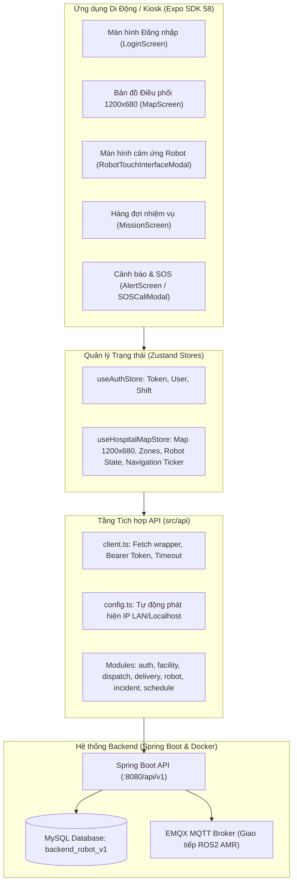
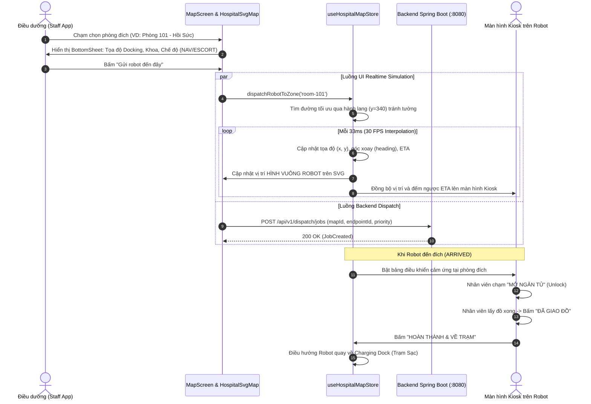

# TÀI LIỆU KIẾN TRÚC HỆ THỐNG VÀ LUỒNG NGHIỆP VỤ MEDIASSIST ROVER (FE APP)

> **Dành cho:** Kỹ sư phần mềm, Thành viên dự án Capstone, Giảng viên & Người tiếp nhận mã nguồn.  
> **Dự án:** Ứng dụng điều phối Robot Y tế Tự hành (MediAssistRover - FE APP & Robot Interface).  
> **Phiên bản:** 2.0 (Hỗ trợ Expo SDK 58, React 19, React Native 0.88, Docker Local Backend).

---

## 1. TỔNG QUAN DỰ ÁN & BỐI CẢNH NGHIỆP VỤ

**MediAssist Rover (MAR)** là hệ thống tích hợp giữa phần mềm và phần cứng robot tự hành (Autonomous Mobile Robot - AMR) phục vụ trong môi trường bệnh viện thông minh, nhằm giảm tải áp lực cho nhân viên y tế và tối ưu hóa an toàn vận hành:

1. **Vận chuyển nội viện tự động:** Vận chuyển thuốc, mẫu bệnh phẩm, vật tư y tế, tài liệu giữa Nhà thuốc, Kho Dược, Phòng Xét nghiệm và các Phòng bệnh/Khoa lâm sàng.
2. **Dẫn đường người bệnh (Escort Mode):** Robot dẫn đường cho bệnh nhân hoặc người nhà tới các phòng khám chuyên khoa với tốc độ an toàn ($0.2\text{ m/s}$).
3. **Ứng cứu khẩn cấp (SOS & Fall Detection):** Tiếp nhận cảnh báo té ngã, cuộc gọi SOS từ phòng bệnh hoặc màn hình robot, mở luồng video/âm thanh thời gian thực.
4. **Hệ thống bản đồ số 2D (Digital Twin 1200x680):** Đồng bộ trực quan giữa **Staff Mobile App** (Điều dưỡng thao tác) và **Robot Touchscreen Kiosk** (Màn hình cảm ứng gắn trực tiếp trên thân robot).

---

## 2. KIẾN TRÚC TỔNG THỂ & HỆ THỐNG FILE LIÊN QUAN



### Sơ đồ cấu trúc thư mục cốt lõi:

```text
d:\UI app\
├── app.json                               # Cấu hình Expo SDK 58.0.0
├── package.json                           # React 19.3.0, RN 0.88.0, Zustand, SVG
├── src/
│   ├── api/
│   │   ├── config.ts                      # Cấu hình Base URL động (Localhost/LAN IP)
│   │   ├── client.ts                      # Http client với Interceptor & Bearer Token
│   │   ├── endpoints.ts                   # Định nghĩa toàn bộ URI endpoint chuẩn Swagger
│   │   ├── types.ts                       # TypeScript interfaces chuẩn Data Contract
│   │   └── modules/                       # Các module API nghiệp vụ
│   │       ├── auth.api.ts                # Đăng nhập, Refresh token, Profile
│   │       ├── facility.api.ts            # Map, Tầng, Phòng, Zone, Waypoint, createHospital
│   │       ├── dispatch.api.ts            # Điều phối robot (Nav, Escort, Cancel)
│   │       ├── delivery.api.ts            # Tạo lệnh giao hàng, xác thực bảo mật
│   │       ├── robot.api.ts               # Telemetry robot, pin, trạng thái
│   │       ├── incident.api.ts            # Sự cố khẩn cấp, té ngã
│   │       ├── alert.api.ts               # Cảnh báo hệ thống
│   │       └── schedule.api.ts            # Lịch trình định kỳ
│   ├── store/
│   │   ├── useAuthStore.ts                # Lưu phiên đăng nhập & ca trực
│   │   └── useHospitalMapStore.ts         # Đồng bộ bản đồ 1200x680 & Thuật toán di chuyển Robot
│   ├── components/
│   │   ├── common/StaffHeader.tsx         # Header chuẩn hiển thị ca trực & nhân viên
│   │   ├── map/
│   │   │   ├── HospitalSvgMap.tsx         # Render SVG mặt bằng, phòng, robot hình vuông
│   │   │   └── RobotTouchInterfaceModal.tsx # Giao diện cảm ứng Kiosk trên robot
│   │   ├── scanning/                      # Quét QR & Nhận diện khuôn mặt (Face Scan)
│   │   └── sos/                           # Modal gọi thoại & xem stream camera robot
│   └── screens/
│       ├── auth/                          # Login, Quên mật khẩu
│       └── main/                          # MapScreen, MissionScreen, AlertScreen, DensityScreen
```

---

## 3. CHI TIẾT CÁC LUỒNG NGHIỆP VỤ CHÍNH

### Luồng 1: Xác thực & Phân quyền (Authentication & Authorization)

1. **Điểm truy cập:** [`src/screens/auth/LoginScreen.tsx`](file:///d:/UI%20app/src/screens/auth/LoginScreen.tsx)
2. **Cơ chế xử lý:**
   - Nhân viên nhập `username` / `password`. Mặc định cấu hình tài khoản Staff Local: `dieuduong01` / `12345678`.
   - Gọi `POST /api/v1/auth/login` -> nhận `accessToken` (JWT) và `refreshToken`.
   - Token được gán vào `apiClient.setToken()` để tự động đính kèm header `Authorization: Bearer <token>` trong tất cả các request tiếp theo.
   - Gọi tiếp `GET /api/v1/staff/me` để lấy thông tin hồ sơ nhân viên (`StaffProfile`), chức danh (*Điều dưỡng trưởng*) và danh sách ca trực đang kích hoạt (`activeShifts`).
3. **Quy tắc bảo mật Local Database:**
   - Trong database backend, trường `must_change_password` của Account phải là `0` để tránh bị Spring Security chặn lỗi `403 Forbidden`.

---

### Luồng 2: Điều phối Robot trên Bản đồ Bệnh viện (Hospital Map Coordination)

Đây là tính năng trung tâm kết nối giữa Staff App và Robot AMR:



#### Chi tiết chuẩn Data Contract giữa 2 App:
Bản đồ và Robot sử dụng cấu trúc dữ liệu thống nhất tại [`src/store/useHospitalMapStore.ts`](file:///d:/UI%20app/src/store/useHospitalMapStore.ts):
- **Kích thước bản đồ chuẩn:** `1200 x 680 pixel` (độ phân giải `0.05 m/px`, tương ứng mặt bằng $60\text{m} \times 34\text{m}$).
- **Danh sách Zone:** Đa giác phòng (`points`), điểm đỗ trả hàng (`dockPoint`), màu khoa phòng nhận diện.
- **Tạo hình Robot:** Bắt buộc là **hình vuông nhỏ** (`<Rect width={28} height={28} rx={6} />`), có cảm biến quét LiDAR phía trước, mũi tên định hướng và nhãn `MAR-01`.

---

### Luồng 3: Quy trình Giao hàng Y tế An toàn (Secure Medical Delivery)

1. **Yêu cầu an toàn cấp dược phẩm/vật tư:**
   - Các gói hàng là *Thuốc đặc trị, Máu, Bệnh phẩm* bắt buộc kích hoạt cấp độ bảo mật cao (`requiresConfirmation: true`).
2. **Quy trình xác thực đa tầng:**
   - Tại điểm gửi (Kho Dược): Nhân viên đóng gói đồ vào ngăn tủ, khóa điện từ.
   - Khi robot đến phòng nhận bệnh: Ngăn tủ tiếp tục khóa cho đến khi người nhận:
     - **Quét mã QR nhân viên y tế** ([`QRScannerModal.tsx`](file:///d:/UI%20app/src/components/scanning/QRScannerModal.tsx)).
     - **Xác thực khuôn mặt Face Scan** ([`FaceScanModal.tsx`](file:///d:/UI%20app/src/components/scanning/FaceScanModal.tsx)) khớp với điều dưỡng phụ trách buồng bệnh.
   - Xác thực hợp lệ -> Robot kích hoạt relay mở chốt tủ đồ.

---

### Luồng 4: Phản ứng Sự cố & Báo động Khẩn cấp (SOS Incident & Fall Detection)

1. **Nguồn kích hoạt:**
   - Bệnh nhân bấm nút SOS gắn tại đầu giường hoặc trong nhà vệ sinh.
   - Robot đi tuần tra phát hiện người té ngã bằng thuật toán AI Camera ([`FallDetectionModal.tsx`](file:///d:/UI%20app/src/components/sos/FallDetectionModal.tsx)).
   - Người bệnh bấm nút SOS khẩn cấp trên màn hình Robot Kiosk.
2. **Phản hồi tức thì trên Staff App:**
   - Phát chuông cảnh báo và rung điện thoại.
   - Hiển thị Popup khẩn cấp kèm vị trí chính xác trên sơ đồ tầng.
   - Nhân viên có thể bấm **"Nhận cuộc gọi"** để mở giao tiếp thoại hai chiều ([`SOSCallModal.tsx`](file:///d:/UI%20app/src/components/sos/SOSCallModal.tsx)) hoặc xem luồng camera trực tiếp từ mắt robot ([`SOSStreamModal.tsx`](file:///d:/UI%20app/src/components/sos/SOSStreamModal.tsx)).

---

## 4. HƯỚNG DẪN KẾT NỐI VÀ VẬN HÀNH

### A. Chạy Backend Local (Docker)
1. Thư mục backend: `D:\BE_MAR\BE_MAR`
2. Đảm bảo cấu hình trong `.env`:
   - `BACKEND_BIND_ADDRESS='0.0.0.0'` (để mở kết nối cho điện thoại qua Wi-Fi).
   - `BACKEND_PORT='8080'`.
3. Lệnh khởi chạy:
   ```bash
   cd D:\BE_MAR
   docker compose up -d
   ```
4. Kiểm tra Swagger UI: `http://localhost:8080/swagger-ui/index.html`

### B. Chạy Frontend Mobile App (Expo SDK 58)
1. Thư mục frontend: `d:\UI app`
2. Lệnh khởi chạy Metro bundler:
   ```bash
   npx expo start --clear
   ```
3. Mở trên thiết bị:
   - **iPhone / iPad:** Mở Camera quét mã QR để mở trực tiếp trong **Expo Go (SDK 58)**.
   - **Web Browser:** Nhấn phím `w` trong terminal để mở trên trình duyệt (`http://localhost:8081`).
   - **Android:** Mở Expo Go và quét mã QR.

---

## 5. BẢNG TỔNG HỢP ENDPOINT BACKEND ĐÃ KẾT NỐI

| Phương thức | URI Endpoint | Chức năng nghiệp vụ | Module quản lý |
| :--- | :--- | :--- | :--- |
| `POST` | `/api/v1/auth/login` | Đăng nhập tài khoản Staff/Admin | `auth.api.ts` |
| `GET` | `/api/v1/staff/me` | Lấy thông tin hồ sơ & ca trực của Staff | `staff.api.ts` |
| `GET` | `/api/v1/maps` | Danh sách bản đồ bệnh viện hoạt động | `facility.api.ts` |
| `GET` | `/api/v1/endpoints` | Tọa độ các điểm đến/trạm sạc (Waypoints) | `facility.api.ts` |
| `GET` | `/api/v1/robots` | Trạng thái pin, telemetry các robot | `robot.api.ts` |
| `POST` | `/api/v1/dispatch/jobs` | Điều phối robot tự hành / dẫn đường | `dispatch.api.ts` |
| `POST` | `/api/v1/jobs/{id}/cancel` | Hủy nhiệm vụ robot đang thực hiện | `dispatch.api.ts` |
| `GET` | `/api/v1/hospital-information` | Danh mục thông tin bệnh viện | `facility.api.ts` |
| `POST` | `/api/v1/hospital-information` | Tạo thông tin bệnh viện (`createHospital`) | `facility.api.ts` |
| `GET` | `/api/v1/alerts` | Danh sách thông báo & cảnh báo | `alert.api.ts` |
| `GET` | `/api/v1/emergency-incidents` | Danh sách sự cố khẩn cấp / SOS | `incident.api.ts` |

---

*Tài liệu này được tạo tự động để làm tài liệu bàn giao kỹ thuật và hướng dẫn phát triển tiếp nối cho dự án.*
