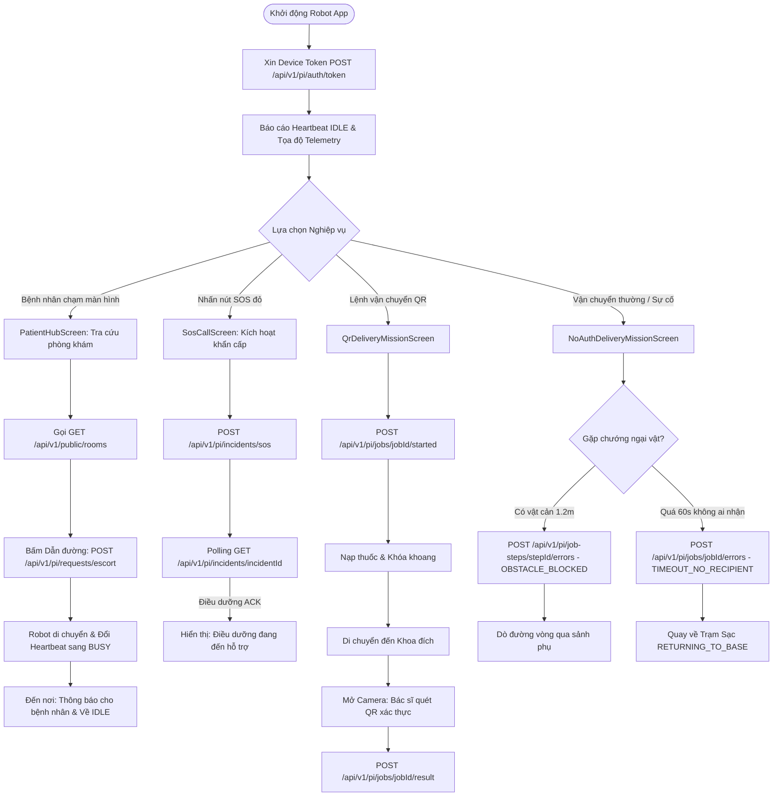

# TÀI LIỆU LUỒNG NGHIỆP VỤ & KIẾN TRÚC TÍCH HỢP API
## Ứng dụng Giao diện Robot Bệnh viện (MediAssist Rover - Robot Interface)

> **Dành cho:** Lập trình viên mới, Kỹ sư tích hợp hệ thống (System Integrator), Tester (QA), và Giảng viên / Hội đồng đánh giá dự án.  
> **Phiên bản hệ thống:** Expo SDK 58.0.0 · React Native 0.88 · Spring Boot 3.x Backend (Port 8080) · EMQX MQTT Broker.

---

## 1. TỔNG QUAN HỆ THỐNG & MỤC TIÊU NGHIỆP VỤ

### 1.1. MediAssist Rover là gì?
**MediAssist Rover (Robot Interface)** là ứng dụng giao diện cảm ứng (Touchscreen HMI) được gắn trực tiếp trên phần cứng robot phục vụ trong khuôn viên bệnh viện thông minh. Robot hoạt động tại các sảnh tiếp đón ngoại trú, hành lang các tầng và các khoa phòng chuyên môn.

### 1.2. Ba Vai trò Nghiệp vụ Chính
1. **Tiếp đón & Hỗ trợ Bệnh nhân (Patient Outpatient Hub):**
   - Giúp bệnh nhân và thân nhân tra cứu thông tin phòng khám, nhà thuốc, khu xét nghiệm.
   - Cung cấp tính năng **Robot Dẫn đường trực tiếp (Patient Escort)**: Robot đi trước dẫn đường với tốc độ an toàn (0.25 m/s), tự dừng khi bệnh nhân tụt lại phía sau và thông báo khi đến cửa phòng khám.
2. **Cấp cứu Y tế Khẩn cấp (Emergency SOS Incident):**
   - Nút ấn cấp cứu tức thì trên màn hình hoặc kích hoạt bằng giọng nói khi phát hiện bệnh nhân ngã/ngất xỉu.
   - Tự động phát còi báo động, truyền tọa độ vị trí chính xác của robot về phòng trực điều dưỡng và kết nối đàm thoại khẩn cấp.
3. **Vận chuyển Thuốc & Vật tư Y tế (Logistics & Delivery Mission):**
   - Nhận nhiệm vụ vận chuyển thuốc, mẫu bệnh phẩm, hồ sơ bệnh án giữa Kho dược/Nhà thuốc và các Khoa điều trị.
   - Hỗ trợ 2 chế độ bảo mật:
     - **Có xác thực danh tính (Secure QR/Face ID):** Người nhận phải quét mã QR định danh cá nhân trên điện thoại hoặc nhận diện khuôn mặt thì khoang chứa thuốc mới mở ra.
     - **Không cần xác thực (Direct Handover):** Bác sĩ/điều dưỡng bấm xác nhận trực tiếp trên màn hình để nhận hàng nhanh.
   - Tự động xử lý các tình huống sự cố ngoài thực tế (**Unhappy Cases**): Vật cản bất ngờ chặn đường, khu vực đông người vượt ngưỡng, hết thời gian chờ người nhận (Timeout 60s), lệnh hủy nhiệm vụ khẩn cấp quay về trạm sạc.

---

## 2. BẢN ĐỒ CẤU TRÚC THƯ MỤC & FILE (FILE MAP)

```text
D:\Robot app\
├── .env                                # Biến môi trường kết nối API cục bộ (Local Backend)
├── app.json                            # Cấu hình Expo SDK 58, quyền Camera, Bundler Metro
├── package.json                        # Thư viện: Expo 58, React 19.3, React Native 0.88, Vitest
├── src/
│   ├── app/
│   │   ├── AppNavigator.tsx            # Điều hướng phân luồng màn hình (Stack Navigator)
│   │   └── navigation.ts               # Định nghĩa Route Param List & Type-safe navigation
│   ├── services/
│   │   └── api/                        # TẦNG GIAO TIẾP VỚI MÁY CHỦ BACKEND (SPRING BOOT)
│   │       ├── config.ts               # Base URL động (Web localhost, Điện thoại LAN IP), Secret Key
│   │       ├── client.ts               # Http Client: Tự động xin Device JWT Token, đính kèm Request-ID
│   │       ├── envelope.ts             # Bộ đóng gói PiEnvelope v1.0 chuẩn giao thức Robot-Server
│   │       ├── robotApiService.ts      # Service trung tâm: Chứa toàn bộ các hàm gọi API REST
│   │       ├── types.ts                # Định nghĩa Typescript Interfaces đồng bộ 100% với Swagger DTO
│   │       └── index.ts                # Export module API
│   ├── features/                       # CÁC MÀN HÌNH NGHIỆP VỤ CHÍNH
│   │   ├── patient/
│   │   │   └── PatientHubScreen.tsx    # [Luồng 1] Tiếp đón bệnh nhân, tra cứu phòng & Dẫn đường
│   │   ├── emergency/
│   │   │   └── SosCallScreen.tsx       # [Luồng 2] Báo động cấp cứu SOS, Polling phản hồi điều dưỡng
│   │   └── logistics/
│   │       ├── QrDeliveryMissionScreen.tsx     # [Luồng 3] Vận chuyển thuốc xác thực mã QR 5 bước
│   │       └── NoAuthDeliveryMissionScreen.tsx # [Luồng 4] Vận chuyển mở, tránh vật cản, quay về trạm
│   ├── components/                     # CÁC COMPONENT TÁI SỬ DỤNG
│   │   ├── IndoorHospitalMap.tsx       # Bản đồ định vị trong nhà (Indoor Vector/SVG Map)
│   │   ├── LogisticsStepper.tsx        # Thanh tiến trình các bước nạp/giao hàng
│   │   └── ui.tsx                      # Button, Card, Notice, AppText chuẩn giao diện y tế
│   └── theme/
│       └── index.ts                    # Bảng màu y tế (Navy `#0A2540`, Teal `#0E9F6E`, Red SOS `#EF4444`)
└── docs/
    └── LUONG_NGHIEP_VU_VA_KIEN_TRUC_API.md # Tài liệu kiến trúc này
```

---

## 3. CHI TIẾT CÁC LUỒNG NGHIỆP VỤ (STEP-BY-STEP FLOWS)



---

### LUỒNG 1: KHỞI TẠO, XÁC THỰC & HEARTBEAT ĐỊNH KỲ

Khi ứng dụng trên Robot khởi động:
1. **Lấy Token thiết bị (`POST /api/v1/pi/auth/token`):**
   - Gửi payload `{ robotCode: "ROBOT_MAR_01", deviceSecret: "6rGL..." }`.
   - Backend xác thực mã bí mật (BCrypt) và trả về `Device Bearer JWT Token` (hạn dùng 60 phút).
   - Token này được `ApiClient` tự động lưu trong bộ nhớ và tự động làm mới khi hết hạn.
2. **Nhịp tim Heartbeat định kỳ (`POST /api/v1/pi/heartbeat`):**
   - Đóng gói dạng `PiEnvelope<HeartbeatPayload>` với `messageType: "HEARTBEAT"`.
   - Báo cáo: Mức pin (`batteryRaw: 79`, `batteryUnit: "UNKNOWN"`), trạng thái robot (`IDLE`, `BUSY`, `ERROR`), phiên bản phần mềm.
3. **Cập nhật tọa độ di chuyển (`POST /api/v1/pi/telemetry/location`):**
   - Báo cáo tọa độ `xM`, `yM`, góc quay `yawRad` và `mapId: "dee53b44-a8ef-446a-947e-c42aa14ce9c2"` để bảng điều khiển web trung tâm vẽ vị trí robot trên sơ đồ bệnh viện theo thời gian thực.

---

### LUỒNG 2: TIẾP ĐÓN BỆNH NHÂN & DẪN ĐƯỜNG NGOẠI TRÚ (PATIENT ESCORT)

Màn hình: `PatientHubScreen.tsx`
1. **Tra cứu danh mục khoa phòng (`GET /api/v1/public/rooms`):**
   - Không yêu cầu token. Lấy danh sách phòng khám từ DB local:
     - `P_CAP_CUU`: Phòng Cấp cứu
     - `P_KHAM_NOI_01`: Phòng khám Nội 01
     - `P_KHAM_NGOAI_02`: Phòng khám Ngoại 02
     - `P_NHA_THUOC`: Nhà thuốc bệnh viện
     - `P_XET_NGHIEM`: Phòng Xét nghiệm máu
     - `P_TIEP_DON`: Ban tiếp đón
2. **Bệnh nhân chọn phòng và bấm "Dẫn đường đến đây":**
   - Gửi yêu cầu qua `POST /api/v1/pi/requests/escort` kèm:
     - `mapId: "dee53b44-a8ef-446a-947e-c42aa14ce9c2"`
     - `destinationEndpointId: "370a77bb-02fd-4008-92f1-d11253a693ab"`
     - `targetMode: "ENDPOINT"`, `escortMode: "GUIDED"`
     - `walkingSpeedMps: 0.250` (Tốc độ bước đi người bệnh)
     - `confirmationTimeoutSec: 60`
   - Backend sinh một ServiceRequest trạng thái `QUEUED` và kích hoạt Job dẫn đường.
3. **Quá trình di chuyển:**
   - Robot cập nhật Heartbeat sang `BUSY`.
   - Màn hình hiển thị thanh tiến trình 4 chặng:
     `Sảnh chính` ➔ `Hành lang A` ➔ `Khu vực Chuyên khoa` ➔ `Trước cửa phòng khám`.
4. **Đến nơi hoặc Hủy bỏ:**
   - Khi đến nơi: Robot phát âm thanh chúc bệnh nhân khám bệnh thuận lợi, gửi Heartbeat về `IDLE`.
   - Nếu bệnh nhân nhấn nút "Hủy dẫn đường": Robot gọi `POST /api/v1/pi/requests/{requestId}/cancel` và chuyển sang trạng thái sẵn sàng đón lượt khách tiếp theo.

---

### LUỒNG 3: CẤP CỨU Y TẾ KHẨN CẤP (EMERGENCY SOS)

Màn hình: `SosCallScreen.tsx`
1. **Kích hoạt khẩn cấp (`POST /api/v1/pi/incidents/sos`):**
   - Khi bệnh nhân nhấn nút đỏ SOS to bản trên màn hình:
   - Gói tin gửi đi:
     ```json
     {
       "protocolVersion": "1.0",
       "messageId": "uuid-v4",
       "operationKey": "sos-op-...",
       "correlationId": "uuid-v4",
       "robotId": "278e1751-36cd-4e24-bb1d-1c151b2396db",
       "messageType": "EMERGENCY_SOS",
       "occurredAt": "2026-10-27T06:48:31.305Z",
       "sequenceNo": 1,
       "payload": {
         "mapId": "dee53b44-a8ef-446a-947e-c42aa14ce9c2",
         "severity": "CRITICAL",
         "description": "Bệnh nhân cần cấp cứu khẩn cấp tại Trạm sảnh Robot",
         "xM": 14.2,
         "yM": 5.8
       }
     }
     ```
   - Máy chủ tạo ngay bản ghi `EmergencyIncident` (`OPEN`), sinh `Alert` chuông đỏ đến toàn bộ điều dưỡng trực và tạo `ServiceRequest` ưu tiên cao nhất (`priority: 100`).
2. **Lắng nghe phản hồi từ Nhân viên y tế:**
   - Robot tự động bật camera, phát âm thanh trấn an bệnh nhân: *"Đã kết nối với đội cấp cứu, xin giữ bình tĩnh..."*.
   - Màn hình thực hiện Polling định kỳ mỗi 3 giây gọi: `GET /api/v1/pi/incidents/{incidentId}`.
   - Khi điều dưỡng trực tiếp nhận trên giao diện web staff (`ACKNOWLEDGED`), màn hình robot lập tức chuyển sang màu xanh lá cây: *"ĐD. Nguyễn Văn A đã tiếp nhận và đang trên đường đến vị trí của bạn"*.

---

### LUỒNG 4: VẬN CHUYỂN THUỐC CÓ XÁC THỰC QR (SECURE DELIVERY)

Màn hình: `QrDeliveryMissionScreen.tsx`
Tiến trình 5 bước đảm bảo an toàn tuyệt đối cho dược phẩm:
- **Bước 1 (Nhận Job):** Gọi `POST /api/v1/pi/jobs/{jobId}/started` ➔ Khoang chứa đồ ở trạng thái sẵn sàng.
- **Bước 2 (Nạp thuốc tại Nhà thuốc):** Dược sĩ mở khoang, đặt khay thuốc có dán niêm phong vào ngăn chứa, đóng nắp khoang và bấm xác nhận nạp xong ➔ Gọi `POST /api/v1/pi/job-steps/{stepId}/result`.
- **Bước 3 (Di chuyển an toàn):** Chốt điện tử khóa cứng khoang chứa trong suốt hành trình robot di chuyển qua các hành lang.
- **Bước 4 (Đến điểm giao & Quét QR):**
  - Robot đến trước Khoa Nội/Ngoại.
  - Màn hình robot kích hoạt camera trước và giao diện quét mã QR.
  - Bác sĩ/Điều dưỡng phụ trách nhận hàng mở app mobile cá nhân đưa mã QR vào trước màn hình robot để định danh.
- **Bước 5 (Mở khoang & Hoàn tất):**
  - Khớp mã định danh thành công ➔ Chốt điện tử tự động nhả mở khoang chứa.
  - Điều dưỡng lấy thuốc ra, đóng nắp khoang.
  - Robot gọi `POST /api/v1/pi/jobs/{jobId}/result` để ghi nhận biên bản giao nhận điện tử.

---

### LUỒNG 5: VẬN CHUYỂN KHÔNG CẦN XÁC THỰC & XỬ LÝ SỰ CỐ (UNHAPPY CASES)

Màn hình: `NoAuthDeliveryMissionScreen.tsx`
Dành cho vật tư tiêu hao thông thường (băng gạc, tài liệu) và kiểm thử khả năng xử lý bất thường của robot:
1. **Xác nhận giao hàng trực tiếp:** Người nhận chỉ cần bấm nút *"Tôi là người nhận"* trên màn hình ➔ Không cần quét QR hay Face ID.
2. **Xử lý sự cố vật cản chắn đường (Ảnh 3 - Obstacle Warning):**
   - Khi LiDAR hoặc Depth Camera phát hiện có giường bệnh hoặc cáng cứu thương chắn ngang đường ở khoảng cách 1.2m:
   - Giao diện chuyển sang màn hình cảnh báo vàng: *"Phát hiện vật cản phía trước, đang dò đường vòng"*.
   - Gọi API: `POST /api/v1/pi/job-steps/{jobStepId}/errors`
     ```json
     {
       "errorCode": "OBSTACLE_BLOCKED",
       "details": { "distance": 1.2, "action": "REROUTING" },
       "retryable": true
     }
     ```
   - Robot tự động tính toán lại đường đi (Global/Local Planner) vòng qua sảnh phụ để tiếp tục nhiệm vụ.
3. **Xử lý sự cố quá giờ chờ người nhận (Timeout 60s):**
   - Bộ đếm thời gian đếm ngược từ 60 giây. Nếu không có ai đến nhận thuốc:
   - Robot tự động khóa khoang chứa bảo vệ an toàn.
   - Báo cáo lỗi: `POST /api/v1/pi/job-steps/{jobStepId}/errors` với `errorCode: "TIMEOUT_NO_RECIPIENT"`.
   - Tự động hủy đơn hàng và kích hoạt lộ trình quay về kho thuốc trung tâm.
4. **Nhân viên hủy nhiệm vụ khẩn cấp (Staff Cancel & Return):**
   - Nếu điều dưỡng hủy lệnh từ trung tâm điều hành:
   - Gọi `POST /api/v1/pi/jobs/{jobId}/errors` với `errorCode: "TASK_CANCELLED_BY_STAFF"`.
   - Robot lập tức chuyển lộ trình về Trạm Sạc / Dock sạc (`RETURNING_TO_BASE`).

---

## 4. CHI TIẾT BẢN ĐỒ API & SCHEMA DTO ĐÃ TÍCH HỢP

| STT | Endpoint | Method | Yêu cầu Token | Gói tin gửi lên (Payload) | Phản hồi máy chủ (200 OK) |
| :--- | :--- | :---: | :---: | :--- | :--- |
| **1** | `/api/v1/pi/auth/token` | `POST` | Không | `{ robotCode, deviceSecret }` | `{ accessToken, tokenType, robotId }` |
| **2** | `/api/v1/pi/heartbeat` | `POST` | Device Token | `PiEnvelope<HeartbeatPayload>` | `{ receivedAt, status: "OK" }` |
| **3** | `/api/v1/pi/telemetry/location` | `POST` | Device Token | `PiEnvelope<LocationPayload>` | `{ receivedAt, duplicate: false }` |
| **4** | `/api/v1/public/rooms` | `GET` | Không | `page=0&size=50` | `PageResponse<RoomResponse>` (6 phòng) |
| **5** | `/api/v1/public/zones` | `GET` | Không | `page=0&size=50` | `PageResponse<ZoneResponse>` (2 zones) |
| **6** | `/api/v1/public/floors` | `GET` | Không | `page=0&size=50` | `PageResponse<FloorResponse>` (3 tầng) |
| **7** | `/api/v1/pi/requests/escort` | `POST` | Device Token | `{ mapId, destinationEndpointId, targetMode, escortMode, walkingSpeedMps, confirmationTimeoutSec, priority }` | `{ serviceRequestId, status: "QUEUED", requestCode }` |
| **8** | `/api/v1/pi/requests/{id}/cancel`| `POST` | Device Token | `{ reason: "Bệnh nhân dừng yêu cầu" }` | `{ serviceRequestId, status: "CANCELLED" }` |
| **9** | `/api/v1/pi/incidents/sos` | `POST` | Device Token | `PiEnvelope<SosPayload>` (messageType: `EMERGENCY_SOS`) | `{ incident: { incidentId, status: "OPEN" }, serviceRequestId, alertId }` |
| **10**| `/api/v1/pi/incidents/{id}` | `GET` | Device Token | Không | `{ incidentId, status: "ACKNOWLEDGED", alertStatus }` |
| **11**| `/api/v1/pi/jobs/{id}/started` | `POST` | Device Token | `PiEnvelope<{}>` | `{ receivedAt, status: "RUNNING" }` |
| **12**| `/api/v1/pi/job-steps/{id}/started`| `POST`| Device Token | `PiEnvelope<{}>` | `{ receivedAt, stepStatus: "RUNNING" }` |
| **13**| `/api/v1/pi/job-steps/{id}/result` | `POST` | Device Token | `PiEnvelope<StepResultPayload>` | `{ receivedAt, stepStatus: "SUCCEEDED" }` |
| **14**| `/api/v1/pi/job-steps/{id}/errors` | `POST` | Device Token | `PiEnvelope<StepErrorPayload>` | `{ receivedAt, retryable: true }` |
| **15**| `/api/v1/pi/jobs/{id}/result` | `POST` | Device Token | `PiEnvelope<JobResultPayload>` | `{ receivedAt, jobStatus: "SUCCEEDED" }` |

---

## 5. CƠ CHẾ VẬN HÀNH KÉP (HYBRID MODE STRATEGY)

Để đảm bảo ứng dụng **không bao giờ bị treo, đứng hình hay văng app (crash)** khi thuyết trình hoặc hoạt động tại khu vực sóng Wi-Fi bệnh viện chập chờn:
1. **Ưu tiên gọi API thật (Real Backend Connection):**
   - Toàn bộ các nút bấm đều gọi qua `robotApiService`. Nếu máy chủ backend local phản hồi `200 OK`, ứng dụng render dữ liệu phòng khám và tọa độ thực tế.
2. **Fallback tự động (Zero-crash Graceful Fallback):**
   - Nếu backend chưa kịp khởi động, token chưa kịp rotate hoặc database rỗng: Hệ thống tự động bắt lỗi (`catch (err)`), hiển thị thông báo chẩn đoán tại **Collapsible API Console** và chuyển sang dữ liệu mẫu chất lượng cao (High-fidelity Hospital Mock).
   - Thanh trạng thái kết nối (Connection Pill) đổi màu thông minh:
     - Xanh lá cây (`#10B981`): `Local Backend (X ms) · Đang kết nối trực tiếp`.
     - Vàng hổ phách (`#F59E0B`): `Chế độ Hybrid Bệnh viện (Nội bộ)`.

---

## 6. HƯỚNG DẪN DÀNH CHO LẬP TRÌNH VIÊN MỚI (QUICKSTART GUIDE)

### Bước 1: Khởi động Backend Spring Boot & MySQL trong Docker
Mở PowerShell tại máy tính:
```powershell
cd "D:\BE_MAR"
docker compose up -d
```
Kiểm tra Swagger UI mở được tại trình duyệt: [http://localhost:8080/swagger-ui/index.html](http://localhost:8080/swagger-ui/index.html)

### Bước 2: Kiểm tra cấu hình môi trường Robot App
File `D:\Robot app\.env` đã được thiết lập:
```dotenv
EXPO_PUBLIC_ROBOT_API_URL=http://localhost:8080
EXPO_PUBLIC_ROBOT_CODE=ROBOT_MAR_01
EXPO_PUBLIC_ROBOT_SECRET=6rGL6RPV9VgbVZfmcHXmA2uz-oST8speM1bO1eI1ozg
EXPO_PUBLIC_USE_MOCK=false
```

### Bước 3: Chạy Typecheck & Unit Tests
```powershell
cd "D:\Robot app"
npm run typecheck    # Kiểm tra kiểu TypeScript (0 lỗi)
npm test             # Chạy 27 unit tests tự động (27/27 Passed)
```

### Bước 4: Khởi chạy Giao diện Expo Go
```powershell
npx expo start -c
```
- **Xem trên trình duyệt PC:** Nhấn phím `w` (mở Web tại `http://localhost:8081`).
- **Xem trên iPhone / iPad thật:** Mở ứng dụng **Expo Go** quét mã QR trên màn hình terminal (Yêu cầu iPhone và PC cùng bắt chung một mạng Wi-Fi `10.1.167.76`).
